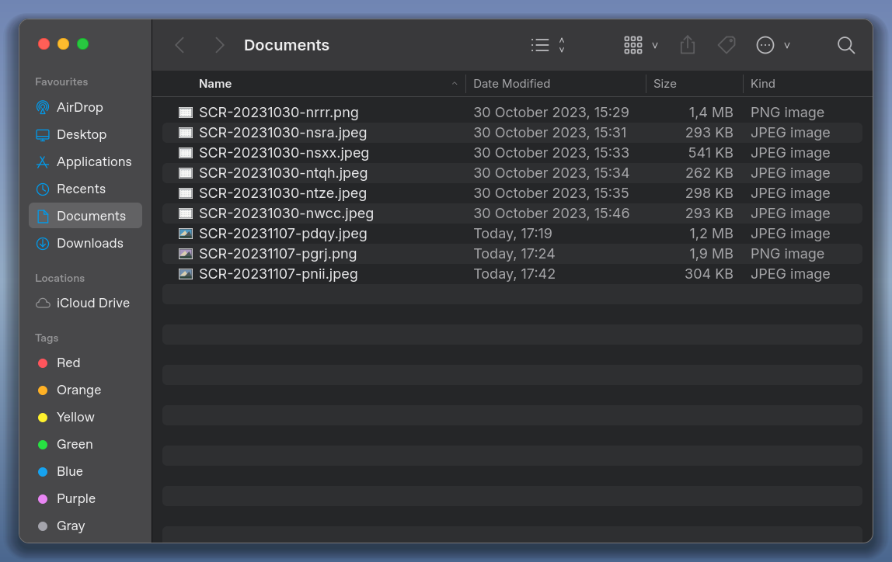
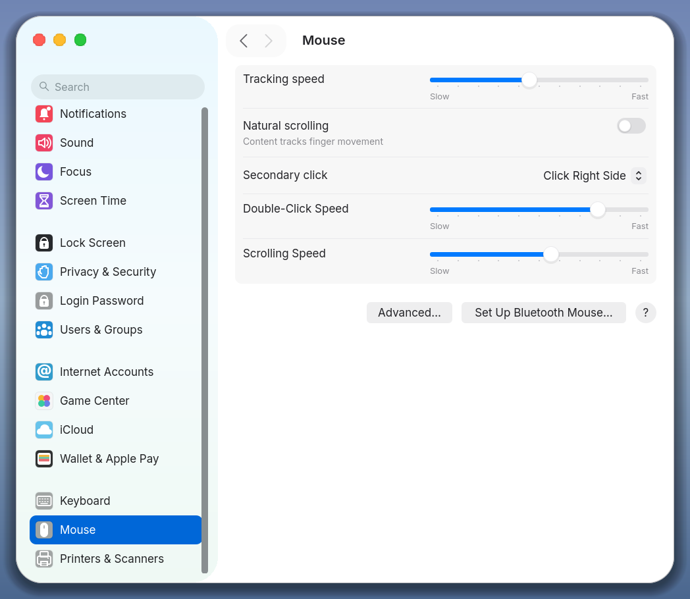
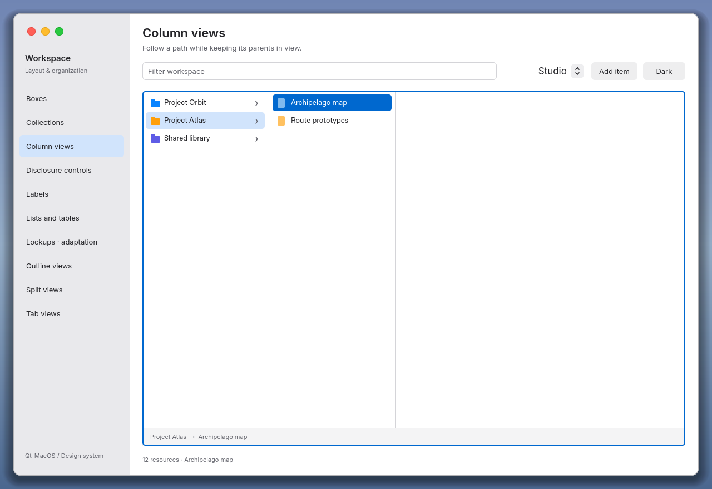
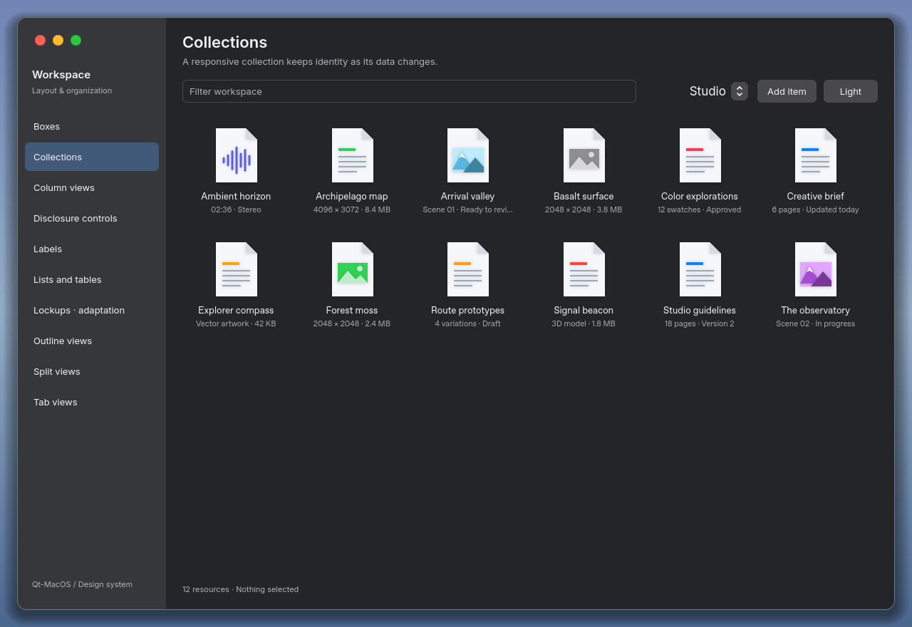

# Qt-MacOS

**macOS-inspired Qt Quick components, with working behavior and real application screenshots.**

[Русская инструкция](README.ru.md) · [Getting started](docs/GETTING_STARTED.md) ·
[For AI coding agents](AGENTS.md) · [Illustrated gallery](docs/LAYOUT_GALLERY.md) ·
[Releases](https://github.com/Kostr2007/Qt-MacOS/releases)

Qt-MacOS is a reusable QML library built **on top of Qt 6**. Its first preview
includes a Finder-inspired browser, Mouse settings, and ten layout families
informed by Apple's Human Interface Guidelines. The components expose selection,
navigation, model and editing contracts for your own application data.

**Status: v0.1.0 preview, source release.** Linux rendering and X11 window
behavior have been tested locally with Qt 6.8.2. The project targets Windows,
Linux and macOS; the [CI matrix](.github/workflows/build.yml) checks all three.
Native Windows/macOS behavior remains to be validated on those systems.

## See it

### Finder-inspired browser



Search, sortable columns, list/grid selection, keyboard navigation, light/dark
appearance, window dragging, resizing and working window buttons.
[Light appearance](docs/screenshots/finder-linux-light.png) ·
[Grid](docs/screenshots/finder-linux-grid.png) · [Behavior and evidence](docs/FINDER_LINUX.md)

### Mouse settings



Sliders, switch, popup, grouped rows, sidebar, Advanced dialog and contextual
help share the component library. The scene stores demo settings in memory;
it does not modify OS mouse settings.
[Dark appearance](docs/screenshots/settings-linux-dark.png) ·
[Advanced dialog](docs/screenshots/settings-linux-advanced.png) · [Details](docs/SETTINGS_LINUX.md)

### Layout and organization





| Family | Public QML type | Behavior |
| --- | --- | --- |
| Boxes | `MacBox` | Related content, title and shared spacing |
| Collections | `MacCollectionView` | Virtualized responsive grid, stable selection |
| Column views | `MacColumnBrowser` | Hierarchy path, keyboard navigation, resizable columns |
| Disclosure controls | `MacDisclosureGroup` | Expand/collapse with keyboard access |
| Labels | `MacLabel` | Semantic text roles and readable hierarchy |
| Lists and tables | `MacListView`, `MacTableView` | Virtualized data, selection, sorting, column sizing |
| Lockups | `MacLockup` | Image and label as a unit; a **tvOS-inspired adaptation** |
| Outline views | `MacOutlineView` | Real tree model, expansion and stable identity |
| Split views | `MacSplitView` | Resizable panes and focus transfer |
| Tab views | `MacTabView` | Keyboard selection and retained page state |

[40 captures across themes, states and datasets, plus 10 interaction frames](docs/LAYOUT_GALLERY.md) ·
[API and model contracts](docs/LAYOUT_IMPLEMENTATION.ru.md) ·
[Verified Apple HIG sources and platform distinctions](docs/HIG_LAYOUT_SOURCES.md)

These illustrations are captures of the actual Qt application. Layout capture
manifests retain commands, image hashes and diagnostics. The shared model also
has 10,000-entry virtualization coverage; images alone do not establish behavior.

## Build and run

Install CMake ≥ 3.21, a C++17 compiler and a compatible Qt 6 kit with Quick,
Quick Controls 2, Quick Test and the SVG image plugin. Qt 6.8.2 is the tested
version; the declared minimum is 6.4 and has not been separately validated.
See [the full guide](docs/GETTING_STARTED.md) for installation and troubleshooting.

```sh
git clone https://github.com/Kostr2007/Qt-MacOS.git
cd Qt-MacOS
cmake -S . -B build -DCMAKE_BUILD_TYPE=Release
cmake --build build --config Release --parallel 4
ctest --test-dir build -C Release --output-on-failure --no-tests=error

./build/qtmacos-gallery
./build/qtmacos-gallery --settings
./build/qtmacos-gallery --layout --page columns
```

If CMake cannot find Qt, pass `-DCMAKE_PREFIX_PATH=/path/to/your/Qt/kit`.
With multi-config generators, run `build/Release/qtmacos-gallery.exe` on Windows
or the corresponding executable path on your platform. Cloning a private
repository requires GitHub access.

Try `--light --grid` for Finder, `--settings --dark`, or
`--layout --page outline --dataset library`. `--presentation` adds a fixed
background for comparison; normal windows use a transparent outer margin.

## Use it in your application

The [complete standalone example](examples/minimal) shows CMake linking,
static QML plugin registration and a working screen:

```sh
cmake -S examples/minimal -B build-example -DCMAKE_BUILD_TYPE=Release
cmake --build build-example --config Release --parallel 4
./build-example/qtmacos-example
```

Link `qtmacosplugin`, register `Q_IMPORT_QML_PLUGIN(QtMacOSPlugin)`, then use:

```qml
import QtQuick
import QtMacOS

MacButton {
    text: qsTr("Create project")
    highlighted: true
    onClicked: console.log("Your application handles the action")
}
```

`Theme.dark` controls appearance. Public components do not access a demo or
Obsidian backend. Controls are selected explicitly; a global Qt Quick Controls
style replacement is not implemented. [Integration instructions](docs/GETTING_STARTED.md#integrate-with-an-application)

An [optional Obsidian pilot](integrations/obsidian/LAYOUT_PILOT.md) demonstrates
the library with a real application's schema and backend. Its cumulative patch
is tested against a pinned commit; it is not a complete Obsidian redesign.

## Scope and verification

The library uses an original QML window shell, Inter and original vector art.
Real macOS vibrancy/background blur, Liquid Glass, native AppKit parity,
Wayland window behavior and full screen-reader/high-contrast auditing are
future work. Finder uses sample data and does not operate on your files.

Local checks cover CMake/CTest, shared model state, mouse/keyboard interactions,
large collections, the consumer example and native Linux/X11 window actions.
Platform CI results are visible in [Actions](https://github.com/Kostr2007/Qt-MacOS/actions);
native behavior still needs platform testing. [Release checks](docs/RELEASE_VALIDATION.md) ·
[Release history](CHANGELOG.md) ·
[Roadmap](docs/PLAN.ru.md) · [Contributing](CONTRIBUTING.md)

## License

Original Qt-MacOS code and documentation: [MIT](LICENSE).
Inter: OFL-1.1. Phosphor icons: MIT. Obsidian patches: GPL-2.0-or-later.
See [third-party notices](THIRD_PARTY_NOTICES.md) for scope and source provenance.
Apple fonts and SF Symbols are not bundled. This is an independent project.
