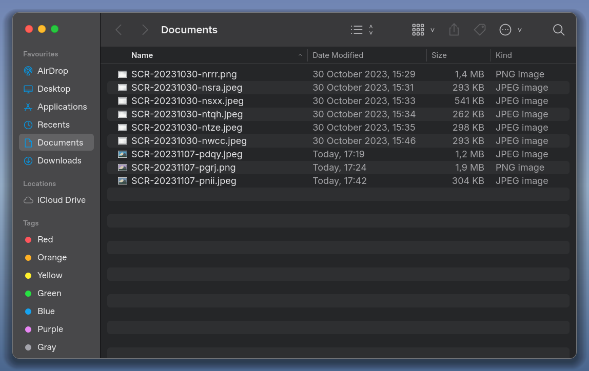

# Qt-MacOS

**v0.1.0 — предварительный выпуск исходников.**
[English](README.md) · [Полная инструкция сборки и подключения](docs/GETTING_STARTED.md) ·
[Инструкция для ИИ](AGENTS.md) · [История изменений](CHANGELOG.md)

Повторно используемые Qt Quick компоненты в духе macOS для Windows, Linux и macOS.
Модуль `QtMacOS` и отдельное Finder-подобное окно: две темы, sidebar,
поиск, сортируемый список и сетка. Linux-демонстрация имеет собственную оконную
оболочку с работающими кнопками, перемещением и изменением размера.
Это библиотека поверх Qt; системная vibrancy пока не реализована.



[Светлая тема](docs/screenshots/finder-linux-light.png) ·
[Сетка](docs/screenshots/finder-linux-grid.png) ·
[Проверка настоящего X11-окна](docs/FINDER_LINUX.md)

Добавлена вторая сцена **Settings → Mouse** на той же оконной оболочке:
[светлая](docs/screenshots/settings-linux-light.png),
[тёмная](docs/screenshots/settings-linux-dark.png),
[меню выбора](docs/screenshots/settings-linux-popup.png),
[Advanced](docs/screenshots/settings-linux-advanced.png).
Запуск: `./build/qtmacos-gallery --settings`.
[Компоненты, API и проверки](docs/SETTINGS_LINUX.md).

**Layout & organization:** десять семейств интерфейса по Apple HIG, 11 общих
QML-компонентов и C++-модель со стабильными ID. Запуск:
`./build/qtmacos-gallery --layout`.
[Галерея 40 снимков и последовательности действий](docs/LAYOUT_GALLERY.md) ·
[API и проверки](docs/LAYOUT_IMPLEMENTATION.ru.md) ·
[пилот в Obsidian](integrations/obsidian/LAYOUT_PILOT.md).

## Сборка

Нужны CMake >= 3.21, C++17, Qt >= 6.4 с Quick, QuickControls2 и QuickTest
(последний нужен при `BUILD_TESTING=ON`). Разработка проверяется на Qt 6.8.2.
Для SVG-иконок галереи необходим SVG image plugin (Debian: `qt6-svg-plugins`).

```sh
cmake -S . -B build -DCMAKE_PREFIX_PATH=/path/to/Qt/6.8/gcc_64
cmake --build build --parallel 4
./build/qtmacos-gallery
```

Если Qt уже обнаруживается CMake, `CMAKE_PREFIX_PATH` не нужен. Для облачной
среды с локальным SDK сначала выполните `source /workspace/qt-sdk/activate.sh`.
С Windows используйте соответствующий Qt kit и компилятор, например MSVC;
исполняемый файл multi-config сборки находится в `build/Debug` или `build/Release`.

```sh
ctest --test-dir build --output-on-failure --no-tests=error
QT_QPA_PLATFORM=offscreen QT_QUICK_BACKEND=software \
  ./build/qtmacos-gallery --presentation --screenshot /tmp/qtmacos-dark.png
QT_QPA_PLATFORM=offscreen QT_QUICK_BACKEND=software \
  ./build/qtmacos-gallery --light --presentation --screenshot /tmp/qtmacos-light.png
```

`--screenshot` сохраняет снимок и завершает приложение с ненулевым кодом при
ошибке. В PowerShell задайте переменные окружения через `$env:NAME='value'`.
Headless-тесты не подтверждают нативные эффекты или оконное поведение других ОС.

Без `--presentation` фон вокруг окна прозрачный; скругления и тень видны при
наличии compositor. `--presentation` добавляет контролируемый синий фон для
сравнения снимков, это не размытие рабочего стола. Поиск раскрывается значком
или Ctrl+F, Escape закрывает его. Переключение темы: меню «…» или Ctrl+Shift+L.
Зелёная оконная кнопка разворачивает/восстанавливает окно, жёлтая сворачивает,
красная закрывает. Перетаскивание — за свободную часть toolbar, resize — за края.

## Использование модуля

Включите каталог проекта через `add_subdirectory`, свяжите приложение с
`qtmacosplugin`, зарегистрируйте `Q_IMPORT_QML_PLUGIN(QtMacOSPlugin)` и импортируйте:

```qml
import QtQuick
import QtMacOS

MacButton {
    text: qsTr("Generate")
    onClicked: console.log("Generate requested")
}
```

`Theme.dark` управляет схемой. Компоненты не обращаются к `backend` приложения.
На этом этапе `MacButton`, `MacTextField`, `MacCheckBox`, `MacComboBox`,
`MacScrollBar`, `SearchField` и `Sidebar` выбираются явно. Глобальная подмена
Qt Quick Controls style ещё не реализована.

Новые публичные типы: `MacWindow`, `WindowButtons`, `MacDialog`,
`MacSlider`, `MacSwitch`, `MacPopupButton`, `MacPushButton`, `MacHelpButton`,
`SettingsGroup`, `SettingsRow`, `SettingsSidebar`, `SettingsIcon`.
Модуль содержит Inter и его QML FontLoader; отдельный demo-resource для шрифта
потребителю не требуется. Для прозрачной оболочки включите
`QQuickWindow::setDefaultAlphaBuffer(true)` до загрузки QML, как в demo/main.cpp.

Layout-типы: `MacLabel`, `MacBox`, `MacDisclosureGroup`, `MacCollectionView`,
`MacLockup`, `MacListView`, `MacTableView`, `MacColumnBrowser`, `MacOutlineView`,
`MacSplitView`, `MacTabView`. Lockup здесь — адаптация tvOS-карточки;
Apple не относит этот паттерн к macOS.

## Статус

План и дальнейшие этапы: [docs/PLAN.ru.md](docs/PLAN.ru.md).
Общая библиотека и галерея разрабатываются до изменения интерфейса Obsidian.
Пилот интеграции Obsidian находится в `integrations/obsidian`.
Патчи Qt и нативные материалы — отдельные следующие этапы.
Приложение показывает фиктивный каталог, не читает и не изменяет файлы.
Share и редактирование тегов явно отключены. Новые Finder-значки и миниатюры
нарисованы собственными векторами; Inter поставляется с OFL-лицензией в
`assets/fonts`. SVG старого прототипа и их лицензия находятся в `assets/icons`.

Проверено локально на Debian 13 / Qt 6.8.2; Windows и macOS включены в
CI-матрицу, но нативное поведение на этих ОС ещё требует проверки.
Минимальный самостоятельный пример: [examples/minimal](examples/minimal).
Публичный API версии 0.x может меняться.

## Лицензия

Наш код и документация — [MIT](LICENSE). Шрифт Inter — OFL-1.1, Phosphor — MIT,
патчи Obsidian — GPL-2.0-or-later. [Все уведомления и источники](THIRD_PARTY_NOTICES.md).
