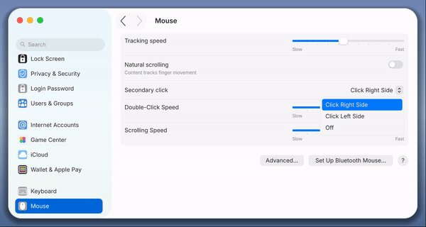
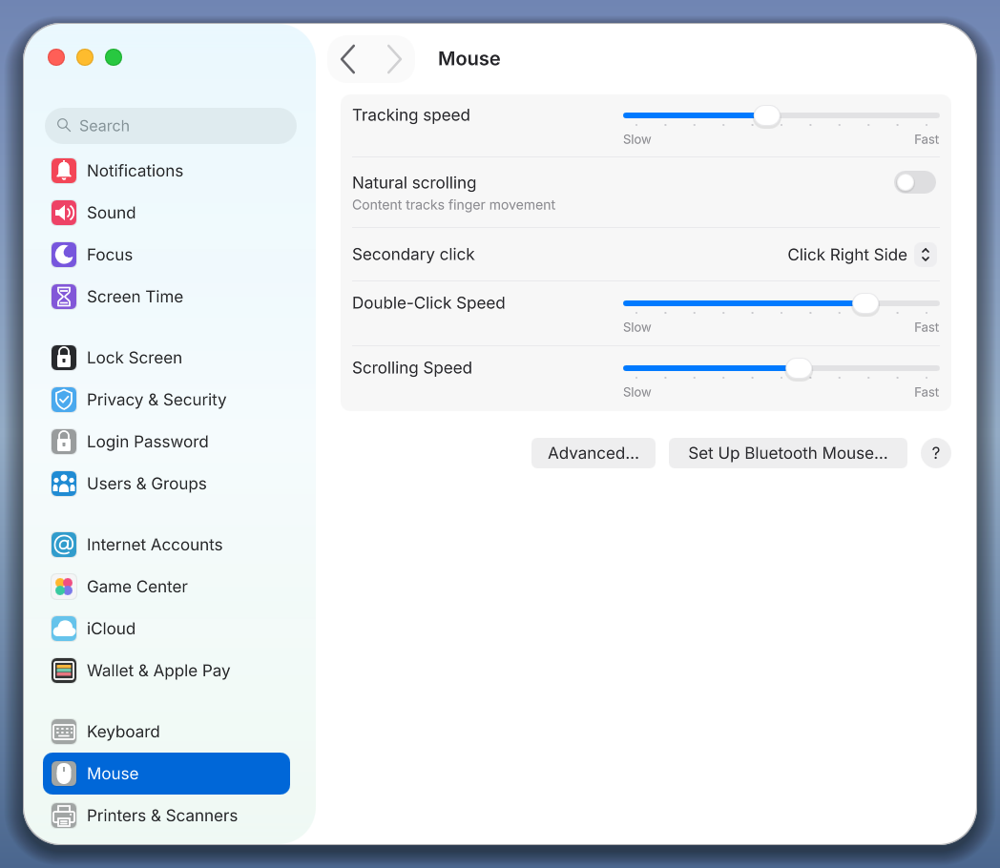
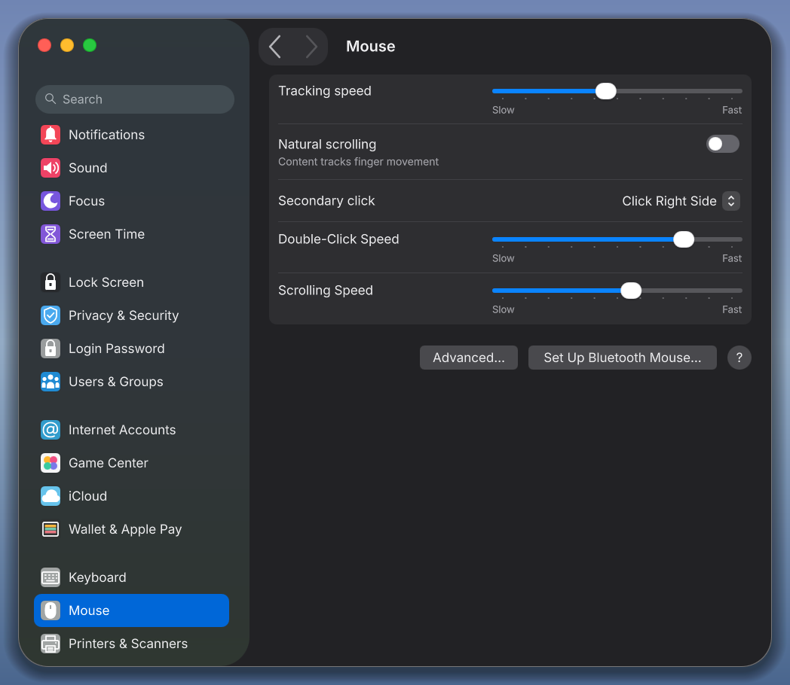
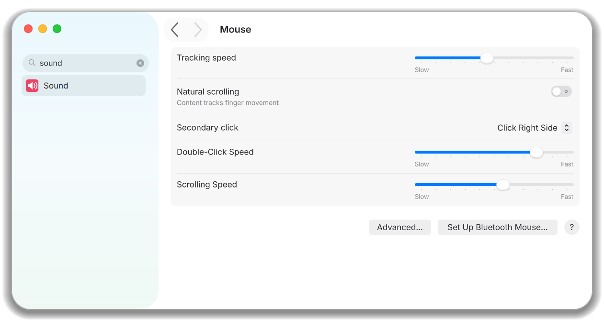
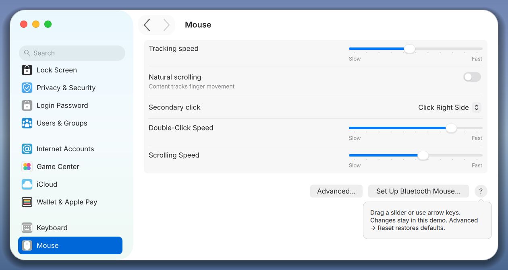
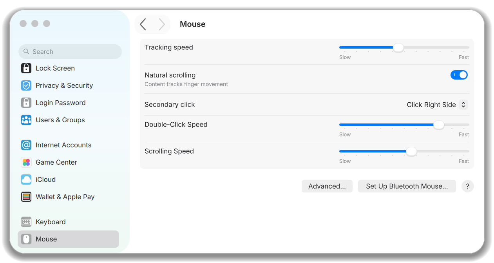
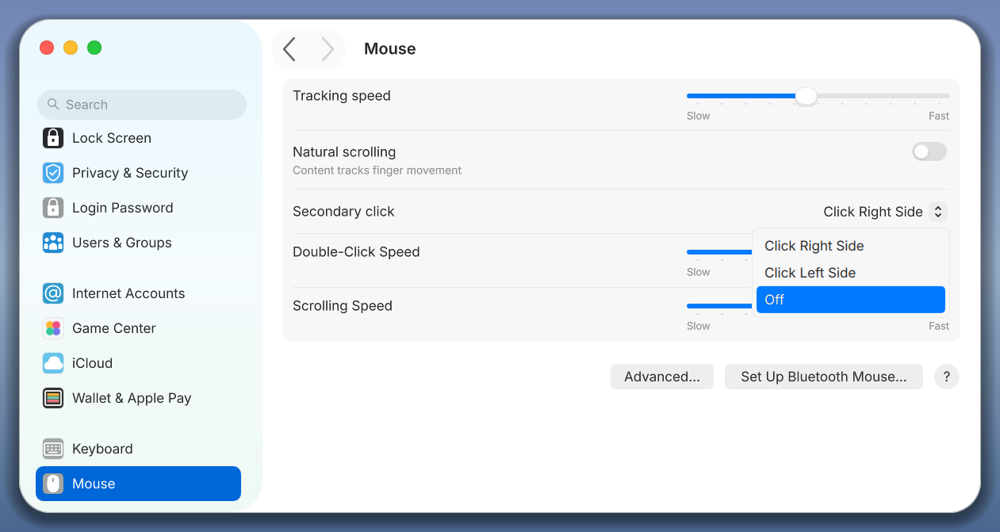
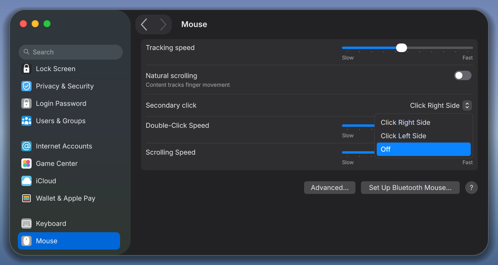
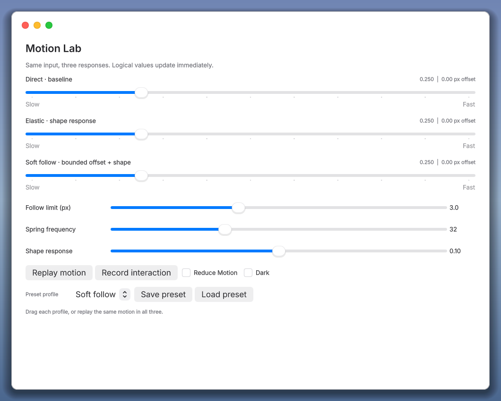

# Qt-MacOS 0.2.0: screenshots and video

Real Qt captures on Linux/X11, Qt 6.12.0, OpenGL. These are application captures,
not design mockups. The fixed background in presentation mode is illustrative;
it does not implement live desktop blur or Liquid Glass.

[Interaction video: navigation, search, switches and popup selection](media/v0.2.0/interactions.mp4) ·
[Popup selection video](media/v0.2.0/popup-selection.mp4) ·
[Popup with Reduce Motion](media/v0.2.0/popup-reduced-motion.mp4).



The GIF is a small sampled preview. MP4 uses the actual capture timestamps;
the overview resizes and letterboxes the recordings. No intermediate interface
states are generated. Instrumented captures affect timing and do not measure
display FPS or input-to-photon latency.

## Settings





## Search, help and inactive selection







## Popup selection





## Motion Lab



## Provenance and reproduction

[Media manifest](media/v0.2.0/manifest.json) records hashes, renderer, Qt version,
capture scenarios and selected frame timestamps. PNGs are copied without editing.
Historical v0.1.0 screenshots remain in [the original layout gallery](LAYOUT_GALLERY.md).

```sh
python3 scripts/prepare_release_media.py --binary build/qtmacos-gallery \
  --tests build/qtmacos-tests --output docs/media/new-capture \
  --recordings recordings/release --platform xcb --ffmpeg /path/to/ffmpeg
```

Use a matching Qt kit, Python 3, ffmpeg and an X11 desktop. Choose a new empty
output directory; the script preserves existing captures. A recording script can
also run separately with `--scenario slider`, `navigation`, `details` or `popup`;
see [the build/recording guide](GETTING_STARTED.md#interaction-recording-and-motion-lab).
Raw sessions go to the ignored recordings directory. Only selected assets and
the portable manifest are published. Scripts use Python's standard library.
With i3, add `--i3-floating` to capture only the script's own windows at the
gallery's intended size; other windows are not targeted.

## По-русски

Это реальные кадры приложения. Видео показывает переходы категорий, поиск,
переключатели и плавное выделение меню. Для проверки мелких деталей запустите
сценарий отдельно и откройте его через `scripts/review_interactions.py`.
Галерея подтверждает внешний вид в указанной среде; результаты тестов и границы
платформенной проверки приведены в [описании проверки выпуска](RELEASE_VALIDATION_v0.2.0.md).
