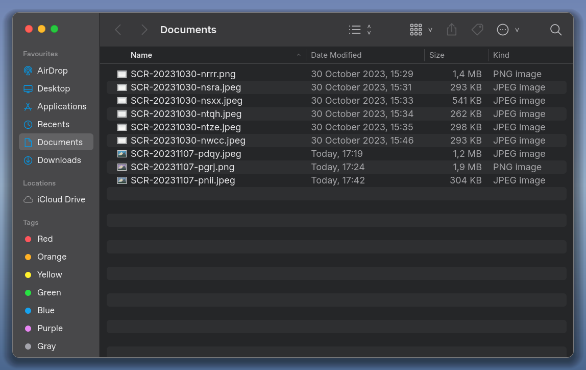
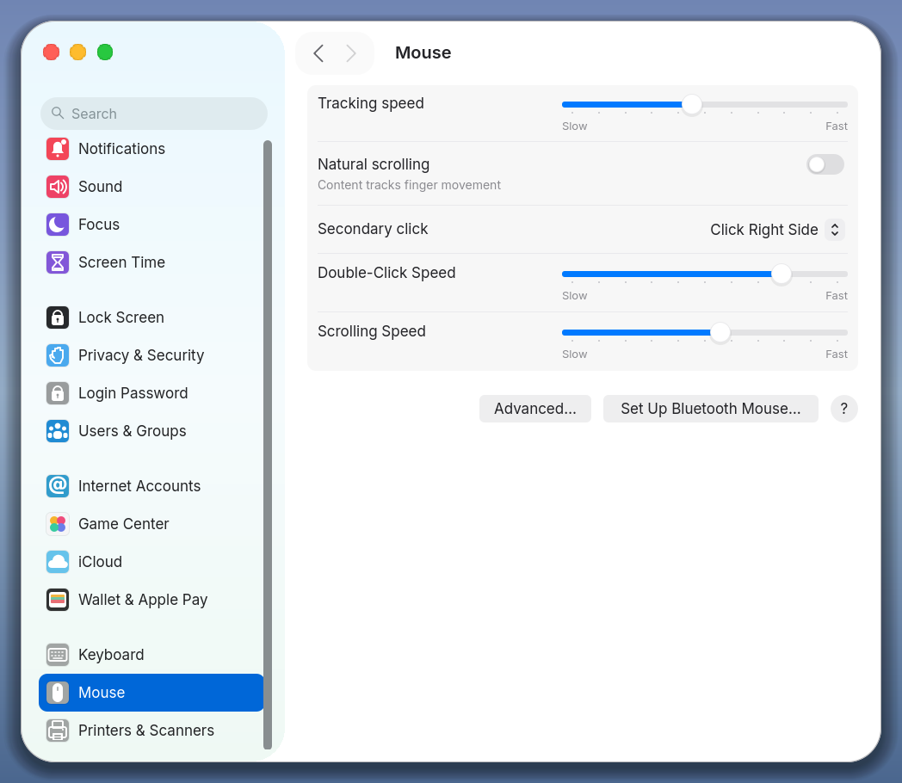

# Qt-MacOS v0.1.0 — Preview

Первый выпуск исходников Qt-MacOS: библиотека компонентов Qt Quick поверх Qt 6,
три рабочие демонстрации и документация для людей и ИИ. Публичный API версии
0.x ещё может меняться.

## Что входит

- Finder-подобное окно: две темы, поиск, сортировка, список/сетка, выбор,
  клавиатура и работающие оконные действия под Linux/X11.
- Mouse settings: слайдеры, переключатель, popup, группы настроек и Advanced.
  Значения демонстрационные, системные настройки не изменяются.
- Десять семейств layout: boxes, collections, columns, disclosure, labels,
  lists/tables, lockups, outline, split views и tabs. Lockups обозначены как
  адаптация паттерна tvOS. Общая модель сохраняет выбор по стабильным ID.
- 40 снимков вариантов и 10 кадров реальных mouse/key взаимодействий,
  manifests с командами/хешами, скрипт повторного захвата.
- Самостоятельный пример подключения, инструкция для ИИ, CMake/CTest,
  CI-матрица Linux/Windows/macOS и проверенные опциональные патчи Obsidian.

## Документация и иллюстрации

- [README с фотографиями](https://github.com/Kostr2007/Qt-MacOS/blob/v0.1.0/README.md)
- [Инструкция на русском](https://github.com/Kostr2007/Qt-MacOS/blob/v0.1.0/README.ru.md)
- [Сборка и подключение](https://github.com/Kostr2007/Qt-MacOS/blob/v0.1.0/docs/GETTING_STARTED.md)
- [Для ИИ: AGENTS.md](https://github.com/Kostr2007/Qt-MacOS/blob/v0.1.0/AGENTS.md)
- [Галерея всех семейств и взаимодействий](https://github.com/Kostr2007/Qt-MacOS/blob/v0.1.0/docs/LAYOUT_GALLERY.md)
- [Пример приложения](https://github.com/Kostr2007/Qt-MacOS/tree/v0.1.0/examples/minimal)





## Запуск

Нужны CMake ≥ 3.21, C++17 и Qt Quick/Quick Controls 2; тестовая версия Qt — 6.8.2.

```sh
cmake -S . -B build -DCMAKE_BUILD_TYPE=Release
cmake --build build --config Release --parallel 4
ctest --test-dir build -C Release --output-on-failure --no-tests=error
./build/qtmacos-gallery
./build/qtmacos-gallery --settings
./build/qtmacos-gallery --layout
```

Для multi-config сборки используйте executable из `build/Release`.
Вложения: архив исходников и `SHA256SUMS.txt`. Qt и runtime-зависимости
в архив не входят; готовые переносимые binaries пока не выпускаются.

## Проверки и ограничения

Локально на Debian 13 / Qt 6.8.2: чистая Release-сборка из архива, CTest 2/2,
QML 74/74 outcomes и C++ 6/6; standalone consumer собран и запущен под X11.
[Подробности проверок](https://github.com/Kostr2007/Qt-MacOS/blob/v0.1.0/docs/RELEASE_VALIDATION.md).
Актуальный статус CI для трёх ОС смотрите в Actions; успешная сборка не
подтверждает все нативные оконные действия на этих ОС.

Это preview: настоящие vibrancy/blur и Liquid Glass, полная интеграция с AppKit,
Wayland и полноценный accessibility audit ещё впереди. Библиотека не является
форком qtbase или глобальной заменой Qt Quick Controls style. Пилот Obsidian
меняет отдельные компоненты, сохраняя backend и генератор.

Наш код — MIT. Inter — OFL-1.1, Phosphor — MIT, патчи Obsidian — GPL-2.0-or-later;
отдельные уведомления и полные тексты лицензий включены в исходники.
