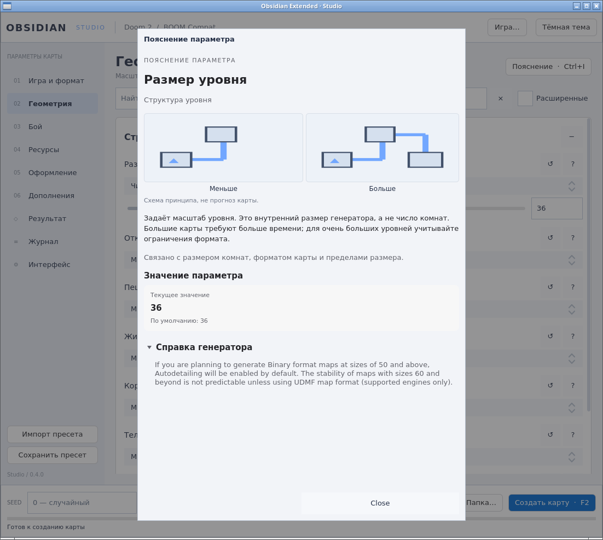

# Layout-пилот в реальном Obsidian

`layout.patch` — самостоятельный накопительный патч к Obsidian commit
`7a9391a28e5ba21f088b164be488ead6d88c00fb`. Он включает первоначальный
`qtmacos.patch` и новый пилот панели пояснения параметра. Применять **один**
из этих патчей на чистую соответствующую ревизию; новый патч не является
добавкой поверх прежнего. Исходный `qtmacos.patch` сохранён без изменений.

Это проверка переноса компонентов в существующее приложение: их данные поступают
из реальной схемы генератора, а не из демонстрационного набора.

| Компонент | Задача в рабочей панели |
| --- | --- |
| `MacLabel` | Роли title, body, secondary и caption задают общую типографическую иерархию пояснения |
| `MacBox` | Связывает текущее значение и значение по умолчанию в тихую логическую группу; высота зависит от содержимого |
| `MacDisclosureGroup` | Раскрывает справку генератора по запросу; сохраняет дочерний текст, поддерживает клавиатуру; новый параметр закрывает старую справку |

Пилот ограничен `StudioInspector`: названием параметра, пояснением, группой живого
значения и справкой. Сохраняются схема/диаграмма параметра, автопрокрутка к началу
при смене параметра и предпросмотр результата. Значение берётся через прежний
`backend.value()` и обновляется при `backend.revision`; подписи вариантов и
boolean-преобразование сохранены. Редактор `OptionEditor.qml`, его reset/help,
choice/switch/slider/точный ввод и `backend.setOption()` не изменены. Engine,
backend, схема, конфигурация и данные пользователя также не изменены.

Overlay `mac/StudioInspector.qml` подменяет ресурс только при непустом
`OBSIDIAN_QTMACOS_ROOT`. С пустым параметром CMake использует исходный
`StudioInspector.qml` вместе с исходными QML/Fusion; библиотека QtMacOS не нужна.
Весь остальной интерфейс Obsidian пока сохраняет собственную композицию и
палитру. Этот шаг не означает полного переноса приложения на стиль macOS.

## Применение

В отдельной чистой рабочей копии указанной ревизии:

```sh
git apply --check /path/to/Qt-MacOS/integrations/obsidian/layout.patch
git apply /path/to/Qt-MacOS/integrations/obsidian/layout.patch
cmake -S . -B build/qt-macos -G Ninja -DCMAKE_BUILD_TYPE=Release \
  -DOBSIDIAN_QT=ON -DOBSIDIAN_QTMACOS_ROOT=/path/to/Qt-MacOS
cmake --build build/qt-macos --parallel 4
QT_QUICK_BACKEND=software ctest --test-dir build/qt-macos \
  -R '^qt-core$' --output-on-failure --no-tests=error
QT_QPA_PLATFORM=offscreen QT_QUICK_BACKEND=software \
  ./obsidian --smoke-output /path/to/new-empty-output
```

В текущей облачной машине: `source /workspace/qt-sdk/activate.sh` и
`export M4=/workspace/qt-sdk/root/usr/bin/m4` перед сборкой. CMake копирует
исполняемые файлы в корень рабочей копии. Пилот выключается отдельной
конфигурацией с `-DOBSIDIAN_QTMACOS_ROOT=`.

## Фото рабочего приложения



Linux/X11, Qt 6.8.2, software rendering, светлая тема. Открыта существующая
модальная панель пояснения при ширине окна 1100 px. Размер уровня 36 получен
из backend; справка раскрыта обычным нажатием. Это снимок приложения, без
подмены содержимого изображения. Обрамление окна и прочая компоновка Obsidian
остаются прежними.

## Проверки

Debian 13 x86_64, GCC 14.2, Qt 6.8.2, Release:

| Проверка | Результат |
| --- | --- |
| Чистое применение `layout.patch` к указанному HEAD | `git apply --check` PASS |
| ON build, `--parallel 4` | PASS |
| `qt-core` с пилотом | PASS, 1/1 suite; QtTest 13 passed, 0 failed, 0 skipped, без QWARN (11 функций + init/cleanup), финальный запуск 9.18 s |
| Новый тест отдельно от остальных | PASS, `qtMacOSParameterInspectorUsesLiveSchema`, 3 outcomes с init/cleanup |
| Живое значение из реальной схемы | Новый тест меняет допустимый choice через backend и сверяет подпись в `MacLabel` |
| Справка | Тест вызывает `clicked` реального header, проверяет expanded/collapsed, сохранность дочернего текста и сброс при смене параметра |
| Реальная генерация после сборки | Exit 0; `success=true`, 59 modules, WAD 2 437 779 bytes, magic `PWAD`, `CONFIG.txt` существует |
| OFF путь после применения патча | Пустой `OBSIDIAN_QTMACOS_ROOT`, сборка `qt-core-tests` PASS; suite 1/1 PASS, 12 outcomes, 7.42 s, без QWARN |
| Linux GUI | Панель открыта, светлая тема включена, справка раскрыта; фото выше |

Smoke report: `/tmp/obsidian-layout-smoke.ndqM1H/qt-smoke.json`.
Логи: `/tmp/obsidian-layout-build.log`, `/tmp/obsidian-layout-ctest.log`,
`/tmp/obsidian-layout-isolated-test.log`, `/tmp/obsidian-layout-smoke.log`,
`/tmp/obsidian-layout-off-build.log`, `/tmp/obsidian-layout-off-ctest.log`.

Windows/macOS и полное визуальное соответствие Obsidian стилю macOS этим пилотом
не проверены. Последующее перенесение других панелей должно сохранять их реальные
данные и взаимодействия аналогично этой панели.
